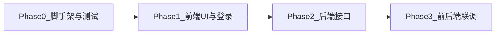

# 智能数据分析系统 — 分阶段实施计划（Phase 0–3）

## 阶段关系总览

- **Phase1 先于 Phase2**：前端用 **Mock 数据 / 本地假登录** 完成可点击、可路由的完整壳；Phase2 再实现真实 API；Phase3 对接并下线 Mock。
- **登录**：与需求文档「范围外：多租户完整账号」一致，采用 **演示级登录**（环境变量或配置文件中的固定账号密码，或 Phase1 仅前端模拟、Phase2 增加 `POST /api/auth/login` 签发短期 Token）。

---

## Phase 0：前后端基础框架与可运行测试

**目标**：仓库结构清晰，本地一条命令能起后端、一条命令能起前端；自动化测试能跑通（哪怕只测「健康检查」与「组件渲染」）。

| 工作项 | 说明 |
|--------|------|
| 目录结构 | 建议 `backend/`（FastAPI）、`frontend/`（React + Vite + TypeScript）；根目录 `README` 写清 Python/Node 版本与启动命令 |
| 后端骨架 | FastAPI 应用入口、`/health` 健康检查；`requirements.txt` 或 `pyproject.toml`；可选 `pytest` + 异步客户端测 `GET /health` |
| 前端骨架 | Vite + React + TS；路由占位；`vitest` + Testing Library 测一个示例组件或根布局 |
| 运行验证 | 文档中写明：`uvicorn` 端口、`npm run dev` 端口；Phase0 验收 = 两服务均可访问 + 测试命令退出码 0 |

**交付物**：可运行的最小后端、可运行的最小前端、通过的测试用例、根 README。

---

## Phase 1：前端 UI（三栏布局）+ 登录可测

**目标**：你能在浏览器中 **登录进入主界面**，看到左侧会话区、中间问答区、右侧图表区的 **完整布局与占位/假数据**，便于录课与走查交互。

| 工作项 | 说明 |
|--------|------|
| 路由 | `/login` 与主应用页（如 `/app` 或 `/` 需登录） |
| 登录 | **演示方案 A**：仅前端校验固定账号，成功后写入 `localStorage`（如 `token` 占位）并跳转；**演示方案 B**：调用 Phase0 已存在的占位 `POST /auth`（若 Phase0 未做，则 Phase1 仍用 A，Phase3 再接真接口） |
| 布局 | 左：会话列表 + 新建/删除（可先操作本地 state）；中：消息列表 + 输入框；右：图表区（ECharts/Recharts 之一，先用 **mock 表格数据** 出一张示例图） |
| 状态 | 会话与消息可用 **前端内存 + localStorage** 持久化，便于刷新后仍能看到列表（可选） |
| 验收 | 打开登录页 → 输入演示账号 → 进入三栏主页 → 能发一条「假消息」并看到右侧图表更新（仍可为 Mock） |

**注意**：本阶段 **不依赖** LangChain、百炼、真实 SQLite 业务库；与 [docs/需求规格说明书.md](docs/需求规格说明书.md) 中 FR-SQL、FR-LM 的实装放在 Phase2。

---

## Phase 2：后端接口与核心业务

**开发规范（全文）**：[docs/Phase2-开发规范.md](../../docs/Phase2-开发规范.md) — 含 Qwen 流式与 `tool_calls` 字段、LangChain SQL Agent 组件说明、**§7.6 NL2SQL Agent 实测入出参**。

**联调脚本**：`backend/scripts/test_qwen_stream_tools.py`（纯 LLM）；`backend/scripts/test_nl2sql_qwen_output.py`（`create_agent` + `SQLDatabaseToolkit` + `qwen3-max`）。

**目标**：实现需求文档中的后端能力：会话与消息、百炼 Qwen3、NL2SQL、记忆、安全执行 SQLite。

| 工作项 | 说明 |
|--------|------|
| 数据层 | SQLite：**元数据**（sessions、messages）；**业务分析库**（示例表或导入脚本）；SQLAlchemy/SQLModel 等任选，与 FastAPI 依赖注入 |
| 认证 | 与 Phase1 对齐：例如 `POST /api/auth/login` 返回 JWT 或 session cookie；后续接口 `Authorization: Bearer` |
| 会话 API | `POST/GET/DELETE /api/sessions`，`GET/PATCH` 按需；消息 `POST/GET .../messages` |
| LLM | LangChain 接入阿里云百炼 Qwen3（OpenAI 兼容或 DashScope，以官方为准） |
| NL2SQL | LangChain SQLDatabase + 链/Agent；只读校验、超时、行数上限；返回 `sql`、`columns`、`rows`、自然语言 `reply` |
| 记忆 | 每 `session_id` 绑定消息历史注入 prompt + LangChain Memory（窗口或摘要） |
| 可选 | SSE 流式端点；若本期不做，接口返回 JSON 即可 |

### Phase 2 参数与接口规范（规划摘要，与规范文档同步）

以下与 [Phase2-开发规范.md](../../docs/Phase2-开发规范.md) **第 1–5 节、第 7.6 节**一致；实现时以规范文档与联调脚本输出为准，版本升级后需回归。

**环境与模型**

| 变量 / 配置 | 说明 |
|-------------|------|
| `DASHSCOPE_API_KEY` 或 `OPENAI_API_KEY` | 百炼 sk，仅服务端 |
| `DASHSCOPE_COMPAT_BASE`（可选） | 默认 `https://dashscope.aliyuncs.com/compatible-mode/v1` |
| `QWEN_MODEL`（可选） | 默认 `qwen3-max` |
| Python 依赖 | `langchain` 1.x、`langchain-core`≥1.2、`langchain-openai`、`langchain-community`、`langgraph`（见 `backend/requirements.txt`） |

**LangChain `create_agent` + `SQLDatabaseToolkit`（NL2SQL）**

| 项目 | 约定 |
|------|------|
| **入参** | `{"messages": [{"role": "user", "content": "自然语言问题"}]}`（可多轮扩展 `system` / `assistant`） |
| **出参顶层** | 仅 **`messages`**（`HumanMessage` / `AIMessage` / `ToolMessage` 交替） |
| **`AIMessage.tool_calls[]`** | 每项含 `name`、`args`（**dict**）、`id`、`type`（实测多为 `"tool_call"`）；中间轮次常见 `content` 为空字符串 |
| **`ToolMessage`** | `content`（工具返回字符串）、`name`、`tool_call_id`（对应上述 `id`） |

**`SQLDatabaseToolkit` 工具在 `tool_calls[].args` 中的键名（实测，勿写死只认 `query`）**

| `name` | `args` 键 |
|--------|-----------|
| `sql_db_list_tables` | `tool_input`（常为空串 `""`） |
| `sql_db_schema` | `table_names` |
| `sql_db_query_checker` | `query` |
| `sql_db_query` | `query` |

**对外 REST / SSE 映射（FastAPI 与前端契约）**

- 从 `messages` 取**最后一条非空 `content` 的 `AIMessage`** → 响应字段 **`reply`**。  
- 从 **`sql_db_query`** 的 `tool_calls[].args["query"]` → **`sql`**。  
- 将对应 **`sql_db_query` 的 `ToolMessage.content`** 解析为表格 → **`data.columns` / `data.rows`**（当前多为 Python 字面量字符串，服务端需安全解析或改执行层直接结构化）。  
- 流式：`agent.stream(..., stream_mode="values")` 每步推送 `messages` 长度递增，**末帧**与 `invoke` 语义一致；SSE 事件形态见规范文档 **§5.2**（`delta`、`tool_calls_ready`、`final`、`error`）。

**交付物**：OpenAPI 文档（FastAPI 自带）、Postman/Thunder 可调的完整接口、后端单测或集成测（至少 health + 一条创建会话 + 一条发消息，可用 mock LLM 或标记为慢测）。

---

## Phase 3：前后端联调

**目标**：前端去掉业务 Mock（或保留为 Storybook 专用），全部走真实后端；登录 → 会话 → 对话 → NL2SQL → 图表数据链路打通。

| 工作项 | 说明 |
|--------|------|
| 配置 | 前端 `VITE_API_BASE_URL`；后端 CORS 允许前端源 |
| 对接 | 登录存 Token；所有 API 带认证头；错误统一 toast/文案 |
| 数据流 | 发送消息后展示助手文本、可折叠 SQL、右侧用返回的 `columns/rows` 驱动图表 |
| 回归 | 按需求文档「验收与测试要点」做一轮手工清单；可选 Playwright 一条冒烟 E2E |

**验收**：与需求文档第 8 节一致——密钥错误不崩溃、典型查询结果正确、恶意 SQL 被拒、会话与图表一致。

---

## 各 Phase 依赖与风险

- **Phase1 无后端**：刻意为之；避免阻塞 UI。风险是接口字段命名需在 Phase2 定稿后与 Phase3 一次性对齐，建议在 Phase2 开始前输出 **简短接口契约**（JSON 字段名：`reply`、`sql`、`data`）。
- **登录**：若希望 Phase1 就调真实登录，需将 Phase2 中的 `auth` 最小实现 **前移** 到 Phase0/1；否则保持「Phase1 纯前端假登录」最省事。

---

## 建议的文档更新（可选）

在 [docs/需求规格说明书.md](docs/需求规格说明书.md) 附录增加「实施阶段（Phase0–3）」一节，与本文档保持一致，便于课程复盘。
